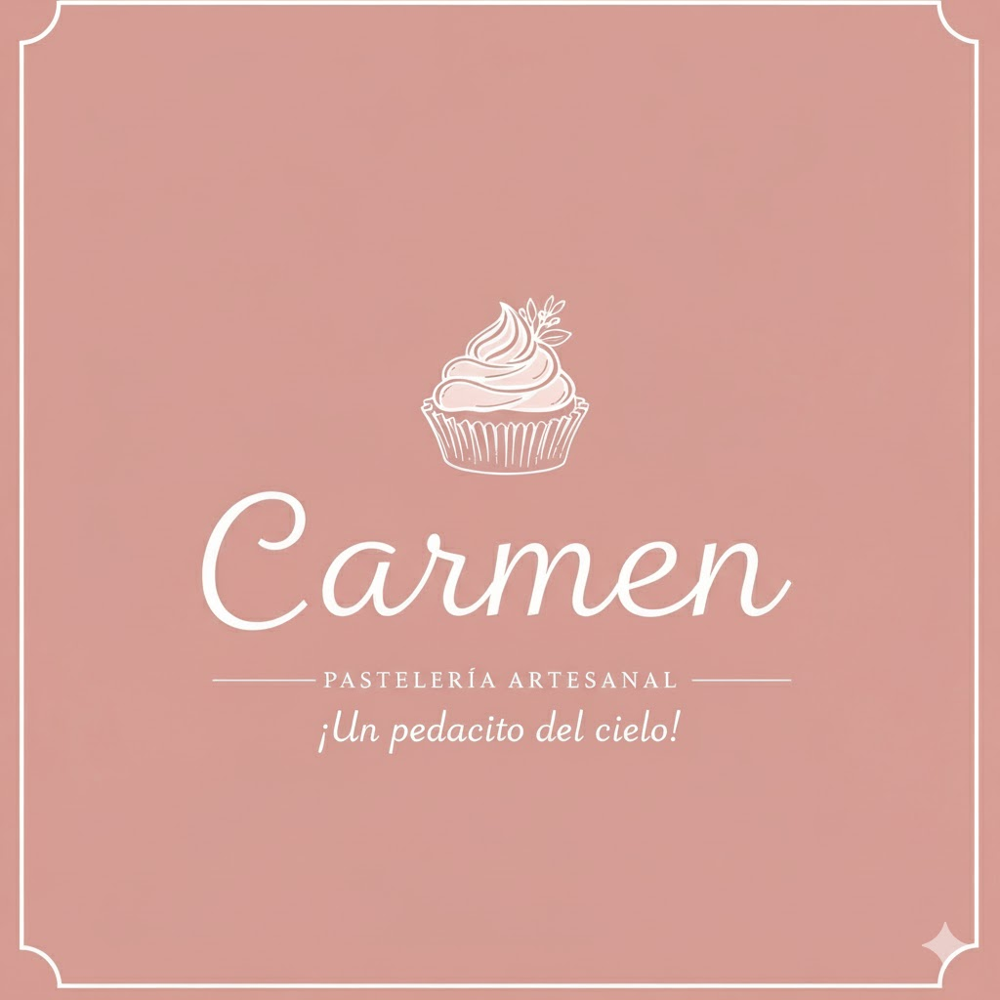

# sis457_pasteleria - Sistema de Gestión de Ventas para la Pastelería "Carmen"

    

## 🍰 Descripción del Proyecto

Este proyecto consiste en el desarrollo de un **Sistema de Gestión de Ventas/Pedidos** diseñado específicamente para la pastelería **"Carmen, ¡Un pedacito del cielo!"**.

La pastelería opera bajo un modelo de venta remota y por encargo, sin una tienda física para compra inmediata.

El sistema está orientado a facilitar la **venta y gestión de pedidos** de su catálogo de productos: pasteles, tartas, pies y cupcakes.

---

## 💻 Arquitectura del Sistema

El sistema implementa una arquitectura de **3 capas** para una separación clara de responsabilidades:

1.  **`CadPasteleria`** (Capa de Acceso a Datos - CAD): Se encarga de la comunicación directa con la base de datos.
2.  **`ClnPasteleria`** (Capa Lógica de Negocio - CLN): Contiene toda la lógica de negocio y las reglas del sistema.
3.  **`CpPasteleria`** (Capa de Presentación - CPN): Es una **Aplicación de Escritorio** (Desktop App) que sirve como interfaz para el usuario.

### 🎯 Funcionalidad Principal

La funcionalidad central y de mayor prioridad es el **Registro de Ventas**.

---

## 📋 Entidades y Relaciones

El modelo de datos se basa en las siguientes entidades clave:

| Entidad | Propósito | Campos Clave (CRUD) | Eliminación Lógica | Observaciones |
| :--- | :--- | :--- | :--- | :--- |
| **Empleado** | Registro de Empleados. | `id`, `cedulaIdentidad`, `nombre`, `apellidoPaterno`, `apellidoMaterno`, `fechaNacimiento`, `direccion`, `celular`, `cargo` | **Sí** (`Estado`) | |
| **Usuario** | Autenticación y Login al sistema. | `id`, `idEmpleado`, `usuario`, `clave` | **Sí** (`Estado`) | |
| **Cliente** | Contactos para la gestión de pedidos. | `id`, `cedulaIdentidad`, `nombre`, `apellido`, `celular`, `email`, `direccion` | **Sí** (`Estado`) | **CRUD de Alta Prioridad.** |
| **Producto** | Catálogo de pastelería disponible para la venta. | `id`, `codigo`,  `nombre`, `unidadMedida`,  `precio`, `tipo`, `descripcion` | **Sí** (`Estado`) | |
| **Pedido** | Cabecera de la transacción de venta. | `id`, `fechaPedido`, `fechaEntrega`, `idCliente`, `idUsuario` | **No** | Registro Histórico. |
| **DetallePedido** | Detalle de los productos incluidos en cada pedido. | `id`, `cantidad`, `precioUnitario`, `subTotal`, `idPedido`, `idProducto`, | **No** | Detalle de Registro. |

---

## 🚀 Puesta en marcha

**Requisitos:** Windows, Visual Studio 2019/2022 (carga de trabajo *Desarrollo de escritorio con .NET*), .NET Framework 4.8 y SQL Server (LocalDB o Express) 2016 SP1 o superior.

1. Clonar el repositorio. **Los paquetes NuGet ya no se versionan** (`packages/` está en `.gitignore`): Visual Studio los restaura al compilar.
2. Ejecutar `database/pasteleria.sql` completo en SQL Server (crea la base `LabPasteleria`, el usuario `usrpasteleria`, tablas, datos de ejemplo y procedimientos).
3. Revisar la cadena de conexión en `AppPasteleria/CpPasteleria/App.config` (por defecto `(localdb)\MSSQLLocalDB`).
4. Abrir `AppPasteleria/Sis457Pasteleria.sln`, establecer **CpPasteleria** como proyecto de inicio y ejecutar (F5).

**Usuarios de ejemplo** (contraseña `hola123`, cámbiela desde *Cambiar contraseña*): `jperez` y `jluis` (ADMINISTRADOR), `mlopez` (CAJERO).

> La aplicación **ya no usa ComponentOne**: no se requiere ninguna licencia ni componente de terceros.

## 🧩 Funcionalidades

| Módulo | Descripción | Rol |
| :--- | :--- | :--- |
| Panel de inicio | Pedidos pendientes, entregas de hoy/atrasadas, ventas del día y del mes, próximas entregas. | Todos |
| Nuevo pedido | Selección de cliente (con alta rápida), productos, cantidades, quitar ítems, total. Un solo guardado transaccional. | Todos |
| Gestión de pedidos | Filtros por fecha/estado/cliente, detalle del pedido, **marcar entregado** y **anular**. | Todos |
| Clientes / Productos | CRUD con validación y baja lógica (la baja sólo la hace un administrador). | Todos |
| Reporte de ventas | Filtro por fechas y cliente, total y **exportación a CSV** (Excel). | Todos |
| Empleados | CRUD con creación de usuario y contraseña temporal. | Administrador |
| Usuarios | Cambiar rol, activar/desactivar, restablecer contraseña. | Administrador |
| Cambiar contraseña | Cada usuario cambia la suya (política: 6+ caracteres, letras y números). | Todos |

Estados del pedido: `1 = PENDIENTE`, `0 = ENTREGADO`, `2 = ANULADO`. Eliminación lógica (`estado`): `-1 = eliminado`, `0 = inactivo`, `1 = activo`.

Más detalle de los cambios realizados en [`docs/CAMBIOS.md`](docs/CAMBIOS.md).

---

## 📅 Cronograma de Hitos

Este es el plan de trabajo con las fechas límite para cada hito:

| Hito | Fecha Límite | Tarea a Completar | Estado |
| :--- | :--- | :--- | :--- |
| **1** | **06/10/2025** | Creación de Repositorio y `README.md`. | ✔️ Completado |
| **2** | **13/10/2025** | Implementación de la Capa de Acceso a Datos (CAD) y consolidación de la estructura de las entidades. | ✔️ Completado |
| **3** | **20/10/2025** | Implementación de la Capa Lógica de Negocios (CLN) y diseño inicial de interfaces (Menú, Vistas de CRUD). | ✔️ Completado |
| **4** | **27/10/2025** | CRUD completo de las entidades **Producto** y **Cliente**. Login funcional y Menú Principal implementados. | ✔️ Completado |
| **5** | **03/11/2025** | Funcionalidad de **Pedido/Venta** inicial. | ✔️ Completado|
| **6** | **10/11/2025** | Refinación y pruebas de la funcionalidad de **Pedido/Venta** y Documentación inicial del proyecto. | ✔️ Completado|
| **7** | **17/11/2025** | **Presentación final** del laboratorio. | ✔️ Completado|
